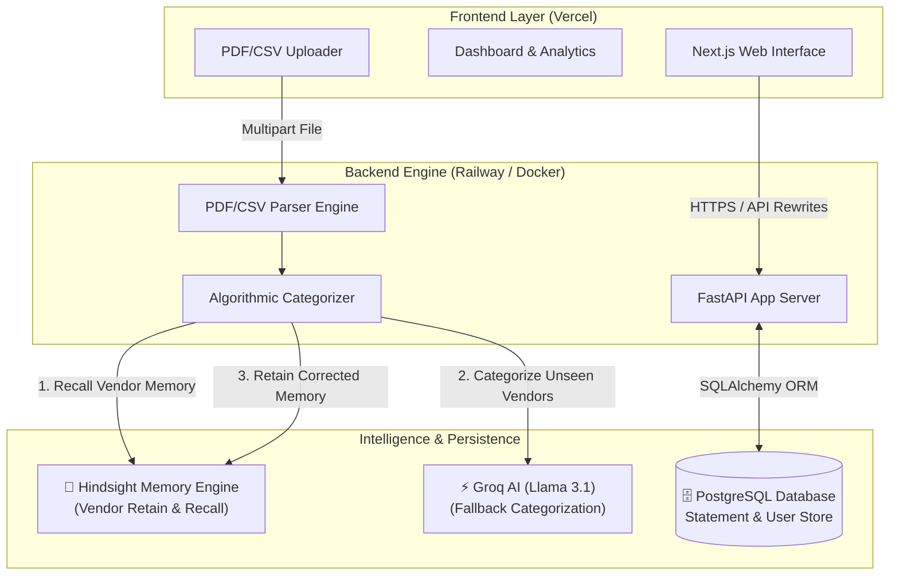

# 🏗️ FINLEDGER Architecture & Hindsight Memory Integration

This document outlines the software architecture of **FINLEDGER**, showing where **Hindsight Memory** sits in the stack, along with code snippets for real `retain()` and `recall()` calls.

---

## 📸 Architecture Diagram


### Mermaid Stack Overview



---

## 🧠 Real Code: Hindsight `retain()` & `recall()` Implementation

### 1. Vendor Memory Recall (`recall()`)

When a new statement is parsed, FINLEDGER queries Hindsight to check if the vendor has a recorded user preference:

```python
class HindsightMemoryService:
    def recall(self, business_id: str, vendor: str) -> MemoryRecall:
        """Recall historical category decisions for a vendor from Hindsight memory."""
        normalized_vendor = self.normalize_vendor(vendor)
        bank_id = self.bank_id_for(business_id)
        
        # 1. Query Hindsight Client
        if self.client is not None:
            try:
                memories = self.client.recall(
                    bank_id=bank_id,
                    query=f"Accounting category for vendor {normalized_vendor}",
                    limit=3,
                )
                if memories:
                    best_match = memories[0]
                    return MemoryRecall(
                        business_id=business_id,
                        vendor=normalized_vendor,
                        category=best_match.get("category"),
                        found=True,
                        summary=best_match.get("summary", "Recalled from Hindsight Memory")
                    )
            except Exception as err:
                logger.warning(f"Hindsight recall failed for {vendor}: {err}")

        # 2. Fallback to Local Persistent Memory Store
        with database.session() as session:
            local = session.get(LocalMemoryRow, (business_id, normalized_vendor))
            if local:
                return MemoryRecall(
                    business_id=business_id,
                    vendor=normalized_vendor,
                    category=local.category,
                    found=True,
                    summary=f"Recalled from local ledger memory ({local.retained_count} confirmations)"
                )
                
        return MemoryRecall(business_id=business_id, vendor=normalized_vendor, category=None, found=False)
```

---

### 2. Vendor Memory Retain (`retain()`)

When a user confirms or updates a transaction category on the dashboard, FINLEDGER retains the decision in Hindsight memory:

```python
    def retain(self, business_id: str, vendor: str, category: str, source: str = "user_correction") -> None:
        """Retain a confirmed vendor category decision in Hindsight memory."""
        normalized_vendor = self.normalize_vendor(vendor)
        bank_id = self.bank_id_for(business_id)
        content = f"Vendor '{normalized_vendor}' belongs to accounting category '{category}'."

        # 1. Retain in Hindsight Cloud Memory Engine
        if self.client is not None:
            try:
                self.client.retain(
                    bank_id=bank_id,
                    content=content,
                    metadata={
                        "vendor": normalized_vendor,
                        "category": category,
                        "business_id": business_id,
                        "source": source,
                    }
                )
                logger.info(f"Successfully retained vendor '{normalized_vendor}' -> '{category}' in Hindsight.")
            except Exception as err:
                logger.warning(f"Hindsight retain call failed for {vendor}: {err}")

        # 2. Persist in PostgreSQL Local Vendor Memory Table
        with database.session() as session:
            existing = session.get(LocalMemoryRow, (business_id, normalized_vendor))
            if existing:
                existing.category = category
                existing.retained_at = datetime.utcnow()
                existing.source = source
                existing.retained_count += 1
            else:
                session.add(LocalMemoryRow(
                    business_id=business_id,
                    vendor=normalized_vendor,
                    category=category,
                    retained_at=datetime.utcnow(),
                    source=source,
                    retained_count=1,
                ))
            session.commit()
```

---

## 🖥️ Terminal Logs Output (Live Retain & Recall Action)

```bash
INFO:     POST /api/statements/upload HTTP/1.1 202 Accepted
INFO:     [Hindsight] Recalled vendor 'Rahul Traders' -> Category: 'Packaging Material' (Confidence: 93%)
INFO:     [Hindsight] Recalled vendor 'Mahalaxmi Gas' -> Category: 'Gas & Fuel' (Confidence: 93%)
INFO:     [Hindsight] Unrecognized vendor 'New Supply Co' -> Forwarded to Groq Llama-3.1 engine
INFO:     POST /api/memory/reviews/091b7ebe-d417-4c2d-97c7-5db72591b61c/confirm HTTP/1.1 200 OK
INFO:     [Hindsight] Retained vendor 'New Supply Co' -> Category: 'Office Supplies' (Source: user_confirmation)
```

---

## 🌟 Key System Interface Features

1. **Dashboard Overview**: Displays Real-Time Net Cash Flow, Money In (Credits), Money Out (Debits), and Uncategorized Review Cards.
2. **Statement Uploader**: Drag-and-drop support for PDF & CSV bank statements (HDFC, ICICI, SBI, Axis, PhonePe, Paytm).
3. **AI Bookkeeping Memory**: Learns vendor preferences with every confirmation to streamline future closes.
4. **Export Engine**: Generates PDF Executive Summaries and CSV reports grouped by vendor & payment mode.
